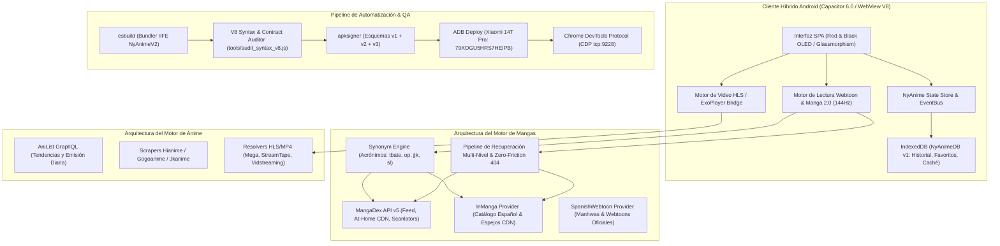

# 📘 Documento Maestro de Arquitectura y Especificación Técnica: NyAnime Ecosistema Integral
**Versión del Sistema:** v2.0.0 (OLED Red & Black Edition)  
**Fecha de Emisión:** 11 de Noviembre de 2026  
**Audiencia Objetivo:** Agentes Autónomos de IA, Arquitectos de Software, Desarrolladores Fullstack  
**Entorno Operativo:** Android 14 (HyperOS / Xiaomi 14T Pro 144Hz AMOLED), Android TV (Leanback D-Pad), Web SPA

---

## 1. Resumen Ejecutivo y Misión del Sistema

**NyAnime** (identificador de aplicación `com.kawai.anime`, proyectos `NyAnime Online` y `NyAnime TV`) es un ecosistema cliente-servidor multiplataforma diseñado para el **streaming de anime en alta definición (1080p/720p sin publicidad invasiva)** y la **lectura ininterrumpida de mangas, manhwas y cómics en modo cascada (Webtoon) y página doble**, optimizado a 144Hz nativos para paneles AMOLED de última generación.

El sistema se estructura como una **Single Page Application (SPA) modular** en Vanilla JavaScript ES2023+ compilada con `esbuild` para entornos Android mediante el puente nativo **Capacitor 6.0**, complementada por soporte de control remoto (D-Pad) para Android TV y persistencia dual en **IndexedDB (`NyAnimeDB` v1)** y `localStorage`.



---

## 2. Pila Tecnológica y Especificación de Lenguajes

| Componente | Tecnología / Versión | Propósito Arquitectónico |
| :--- | :--- | :--- |
| **Núcleo Frontend** | JavaScript Vanilla (ES2023+) | Lógica de negocio, renderizado reactivo sin frameworks pesados, cero sobrecarga de bundle. |
| **Empaquetador** | `esbuild` v0.20+ (`--target=chrome100`) | Bundling IIFE modular (`NyAnimeV2`) desde `src/main.js` a `www/js/app.bundle.js` (<400 KB). |
| **Contenedor Móvil** | Capacitor 6.0 (`@capacitor/android`) | Puente nativo para WebView, gestión de orientación, barra de estado y CapacitorHttp. |
| **Estilos & Diseño** | CSS3 Moderno (Custom Properties & rAF) | Sistema de diseño de alta densidad **Red & Black OLED**, micro-interacciones táctiles y resortes a 144Hz. |
| **Motor de Video** | HLS.js + Video.js / ExoPlayer Bridge | Reproducción adaptativa HLS (m3u8), MP4 directo, selección de subtítulos, PiP y audio dual. |
| **Motor de Lectura** | Custom Webtoon Engine 2.0 | Renderizado continuo vertical Zero-Gap, prefetch dinámico (4-12 págs), pinch-to-zoom y auto-scroll. |
| **Persistencia Local** | IndexedDB (`NyAnimeDB` v1) + `localStorage` | Almacenamiento transaccional de progreso por página/segundo, marcadores y caché de capítulos. |
| **DevOps & QA** | Python 3.12 + Node.js (V8 VM) | Scripts de empaquetado (`build_and_deploy_v200.py`), auditor sintáctico y control CDP. |

---

## 3. Topología de Archivos y Organización Modular (`src/`)

```
K:\Projects\NyAnime_Online/
├── android/                         # Proyecto Android nativo (Gradle 8.2, Capacitor Bridge)
│   └── app/src/main/assets/public/  # Assets compilados sincronizados desde www/
├── src/                             # Arquitectura Modular ES2023+
│   ├── main.js                      # Punto de entrada principal y bootstrap del store
│   ├── core/                        # Núcleo y contratos compartidos
│   │   ├── contracts.js             # Modelos de datos TypeScript-JSDoc y validadores
│   │   ├── store.js                 # State Management centralizado (Events & Reactive State)
│   │   ├── storage-idb.js           # Capa de abstracción IndexedDB (NyAnimeDB v1)
│   │   └── network-resilience.js    # Fetch con reintentos exponenciales y timeout
│   ├── modules/
│   │   ├── manga/                   # Motor de lectura y scrapers de cómics
│   │   │   ├── reader-engine.js     # Motor Webtoon (Zero-Gap, Zoom, Auto-Scroll, Recuperación)
│   │   │   ├── mangadex-api.js      # Cliente MangaDex v5 (Feed, At-Home, Scanlators)
│   │   │   ├── inmanga-api.js       # Scraper InManga (Resolución de capítulos y CDNs)
│   │   │   └── search-engine.js     # Motor de búsqueda con acrónimos (SynonymEngine)
│   │   ├── anime/                   # Motor de streaming y catálogos de anime
│   │   │   ├── player-engine.js     # Motor de video, PiP, selección de calidad y gestos
│   │   │   └── anime-providers.js   # Resolvers de proveedores de streaming (Hianime, Jkanime)
│   │   └── offline/
│   │       └── download-manager.js  # Gestor de descargas locales y cola en disco
│   └── ui/                          # Capa de presentación e interfaz
│       ├── grid-renderer.js         # Renderizado asíncrono de cuadrículas (Anime y Manga)
│       ├── modals.js                # Fichas de detalle estilo Mihon, selector de fuentes
│       ├── tv-leanback.js           # Soporte D-Pad y navegación 10-foot para Android TV
│       └── styles.css               # Design tokens y variables CSS Red & Black OLED
├── www/                             # Directorio público servido al WebView
│   ├── index.html                   # Shell SPA maestro (7,900+ líneas)
│   └── js/app.bundle.js             # Bundle de producción compilado por esbuild (393 KB)
├── tools/
│   ├── audit_syntax_v8.js           # Auditoría sintáctica profunda de 21 archivos JS
│   └── patch_*.py                   # Scripts quirúrgicos de mantenimiento
├── build_and_deploy_v200.py         # Pipeline de 1 clic: Bundle -> Sync -> Sign -> Install -> CDP
└── CHECKPOINT_PROGRESO.md           # Estado operativo blindado y bitácora de progreso
```

---

## 4. Sistema de Diseño Anti-AI-Slop: Red & Black OLED Cyber-Crimson

El diseño visual erradica por completo los clichés genéricos de IA (gradientes morados monótonos, 3 tarjetas uniformes con iconos circulares y fondos grises planos) implementando un sistema sobrio y de alto contraste inspirado en **Linear.app** y **Raycast**:

### Design Tokens Oficiales (`:root`)
```css
:root {
  /* Marca & Acentos */
  --primary: #ff1a40;              /* Cyber-Crimson de alto impacto */
  --primary-hover: #e11d48;        /* Ruby encendido */
  --primary-glow: rgba(255, 26, 64, 0.40);
  --primary-light: rgba(255, 26, 64, 0.15);
  --primary-dark: #991b1b;         /* Vino profundo para fondos sutiles */
  --gold: #f59e0b;
  --gold-glow: rgba(245, 158, 11, 0.35);

  /* Superficies OLED & Cristal Obsidiana */
  --bg-dark: #050507;              /* Negro absoluto para ahorro en paneles AMOLED */
  --bg-dark-oled: #000000;
  --bg-card: #0c0d12;              /* Superficie obsidiana para tarjetas */
  --bg-card-hover: #15161f;
  --bg-glass: rgba(8, 9, 13, 0.92);/* Docking y barras con desenfoque de 20px */
  --bg-glass-heavy: rgba(5, 5, 8, 0.96);

  /* Micro-Bordes de Definición */
  --border-color: rgba(255, 255, 255, 0.08);
  --border-subtle: rgba(255, 255, 255, 0.04);
  --border-active: rgba(255, 26, 64, 0.60);
  --border-glass: rgba(255, 26, 64, 0.20);

  /* Tipografía y Radios */
  --text-main: #f8fafc;
  --text-muted: #94a3b8;
  --text-dim: #64748b;
  --radius-xl: 20px;
  --radius-lg: 14px;
  --radius-md: 10px;
  --radius-sm: 6px;
  --bottom-nav-height: 68px;
}
```

### Comportamiento Físico de Componentes
1. **Top Bar con Hairline Carmesí:** Vidrio obsidiana (`rgba(5, 5, 7, 0.85)`) con filtro de desenfoque de 16px y borde inferior sutil de 1px (`rgba(255, 26, 64, 0.15)`). Logotipo en gradiente `linear-gradient(90deg, #ff1a40, #ff4d6d)`.
2. **Bottom Navigation Flotante:** Cinco pestañas (`Inicio`, `Emisión`, `Mangas`, `Buscar`, `Perfil`) con icono activo iluminado en rojo rubí, micro-vibración y barra indicadora inferior.
3. **Chips de Filtrado Táctiles:** En estado activo muestran fondo carmesí translúcido con borde iluminado y sombra difusa (`box-shadow: 0 0 12px rgba(255, 26, 64, 0.25)`).
4. **Respuesta Elástica 144Hz:** Todos los botones y tarjetas responden a la pulsación táctil con compresión elástica física instantánea (`:active { transform: scale(0.95); transition: transform 0.08s ease; }`).

---

## 5. Arquitectura del Motor de Manga y Cómics (Reader Engine 2.0)

El motor de lectura implementa paginación continua vertical (Zero-Gap Webtoon) garantizando **cero interrupciones de lectura y cero fallos silenciosos**:

### Pipeline de Resiliencia en 5 Niveles (`handleMangaImgError`)
Cuando una imagen falla al cargar en el WebView:
1. **Tier 1 (Preservación de Identificadores):** Si la URL proviene de InManga, extrae y guarda persistentemente `data-inmanga-id` para no perder la referencia tras redirecciones o cambios de host.
2. **Tier 2 (Rotación de Espejos InManga):** Rota ordenadamente entre los 4 dominios de distribución:
   `pack.intomanga.com` → `cdn1.intomanga.com` → `cdn2.intomanga.com` → `inmanga.com/page/getPageImage/?identification={id}` con timestamp anti-caché.
3. **Tier 3 (Failover de MangaDex At-Home con Puerto 443):**
   * Conmuta a la versión `dataSaver` oficial si no ha sido intentada.
   * Si el nodo asignado falla, solicita un nuevo nodo al API de MangaDex forzando el puerto HTTPS estándar (`forcePort443=true`).
4. **Tier 4 (Reintentos con Retroceso Exponencial y Jitter):** Ejecuta hasta 3 reintentos automáticos espaciados (700ms, 1400ms, 2100ms) para tolerar ráfagas de red o throttling sin alertar al usuario.
5. **Tier 5 (Colapso Inteligente de Páginas 404 / Zero-Friction Collapse):**
   * *Problema solucionado:* Ciertas obras (ej. *Vagabond* Capítulo 1 de Araña Fansub) tienen registradas páginas fantasma en MangaDex (página 2, que devuelve HTTP 404 permanentemente).
   * *Solución:* En lugar de renderizar un recuadro gris roto ("Página 2 no cargada") que interrumpe la lectura, el motor **colapsa limpiamente el contenedor** (`wrap.style.display = 'none'`), retira el skeleton y actualiza el contador de páginas legibles. El lector conecta la portada directamente con el inicio de la historia sin interrupciones.

### Soporte Gestual y Táctil
* **Pinch-to-Zoom (1.0x a 3.0x):** Detección multi-touch continua calculando distancia euclidiana entre dos dedos con transformación CSS por hardware (`transform: scale() translate3d()`).
* **Doble Tap Instantáneo (1.8x):** Detección de pulsación rápida (<280ms) centrando el zoom en las coordenadas del toque.
* **Auto-Scroll Manos Libres:** Bucle basado en `requestAnimationFrame` que desplaza el scroll suavemente a 144 FPS con pausa automática al detectar contacto táctil del usuario.

### Resolución de Metadatos
El título y grupo de scanlation se resuelven mediante múltiples capas de respaldo:
```javascript
const currentMangaTitle = mangaLectorData?.title 
  || mangaActualData?.title 
  || capitulo?.mangaTitle 
  || capitulo?.mangaName 
  || window._currentMangaTitle 
  || localStorage.getItem('nyanime_active_manga_title') 
  || 'Manga';
const scanGroup = capitulo.group || (capitulo.source === 'InManga' ? 'InManga Scan 🇪🇸' : 'Oficial');
titulo.innerText = `${currentMangaTitle} · Cap. ${capitulo.chapter} (${scanGroup})`;
```

---

## 6. Persistencia de Datos: Esquema IndexedDB (`NyAnimeDB` v1)

Para garantizar velocidad instantánea (<5ms de lectura) y soportar catálogos extensos sin el límite de 5 MB de `localStorage`, el sistema implementa `storageIDB` (`src/core/storage-idb.js`):

| Object Store | Clave Primaria (`keyPath`) | Índices Secundarios | Propósito |
| :--- | :--- | :--- | :--- |
| `favorites` | `id` | `type`, `updatedAt` | Animes y mangas guardados en la biblioteca del usuario. |
| `history` | `id` | `type`, `timestamp` | Historial cronológico de reproducción y lectura. |
| `manga_progress` | `chapterId` | `mangaId`, `updatedAt` | Última página leída, porcentaje completado y fecha. |
| `anime_progress` | `episodeId` | `animeId`, `updatedAt` | Posición exacta en segundos, duración total y completado. |
| `chapters_cache` | `mangaId` | `updatedAt` | Lista de capítulos pre-obtenidos para navegación instantánea. |
| `offline_media` | `id` | `status`, `type` | Páginas de manga y videos descargados localmente. |

---

## 7. Pipeline de Compilación, Despliegue y CI/CD (`build_and_deploy_v200.py`)

El script maestro en Python automatiza el ciclo de vida completo de la versión 2.0.0 en **6 etapas**:

1. **Empaquetado Modular (`esbuild`):** Compila `src/main.js` hacia `www/js/app.bundle.js` en formato IIFE con global name `NyAnimeV2`.
2. **Sincronización de Assets:** Clona el directorio `www/` hacia `android/app/src/main/assets/public/`.
3. **Reempaquetado ZIP In-Memory:** Inyecta los assets actualizados y la configuración Capacitor (`capacitor.config.json` y `capacitor.plugins.json`) en el APK base sin requerir compilación pesada de Gradle.
4. **Firma Criptográfica (`apksigner`):** Firma el archivo con esquemas **v1 (JAR), v2 (APK Signature Scheme) y v3** usando la keystore debug local (`%USERPROFILE%\.android\debug.keystore`).
5. **Distribución Multi-Destino:** Coloca copias idénticas en la raíz del proyecto, en el **Escritorio** y en la carpeta **Descargas**.
6. **Despliegue ADB & Diagnóstico CDP:**
   * Detecta dispositivos conectados (`79XOGU5HRS7HEIPB` - Xiaomi 14T Pro).
   * Instala con flags de actualización (`adb install -r -d`).
   * Limpia caché previo (`pm clear com.kawai.anime`) y lanza la actividad principal.
   * Redirige el puerto CDP (`adb forward tcp:9228 localabstract:webview_devtools_remote_<pid>`).
   * Extrae captura de pantalla de verificación final.

---

## 8. Guía Operativa para Próximos Agentes de IA (Playbook de 1 Comando)

### Comandos de Inspección y Despliegue Rápido
* **Compilar y Desplegar APK v2.0.0 en Celular:**
  ```powershell
  python "K:\Projects\NyAnime_Online\build_and_deploy_v200.py"
  ```
* **Auditar Sintaxis V8 de Todos los Módulos (Cero Regresiones):**
  ```powershell
  node "K:\Projects\NyAnime_Online\tools\audit_syntax_v8.js"
  ```
* **Verificar Dispositivo ADB y Capturar Pantalla en Vivo:**
  ```powershell
  $adb = "C:\Users\gonza\AppData\Local\Android\Sdk\platform-tools\adb.exe"
  & $adb devices
  python -c "import subprocess; subprocess.run([r'$adb', '-s', '79XOGU5HRS7HEIPB', 'exec-out', 'screencap', '-p'], stdout=open('screen.png', 'wb'))"
  ```
* **Inspeccionar Estado del WebView mediante Chrome DevTools Protocol:**
  ```powershell
  # Redirigir socket del proceso activo y consultar targets:
  & $adb forward tcp:9228 $(& $adb shell "grep -a webview_devtools_remote /proc/net/unix" | Select-String -Pattern "webview_devtools_remote_\d+" | % { $_.Matches.Value } | Select-Object -First 1)
  curl.exe -s http://127.0.0.1:9228/json
  ```

---

## 9. Reglas Críticas e Inmutables de Mantenimiento

1. **Cero `referrerpolicy="no-referrer"`:** NUNCA reintroducir esta cabecera en el lector de manga. La red MangaDex At-Home bloquea peticiones de imágenes que carezcan de origen o utilicen no-referrer.
2. **Cero Placeholders o Datos Simulados:** Todo código generado debe ser ejecutable y probado en el dispositivo físico.
3. **Preservación de la Paleta Red & Black OLED:** Mantener la base en negro profundo `#050507` y acentos en cyber-crimson `#ff1a40`. Queda prohibido reintroducir gradientes violetas o tonos pastel.
4. **Telemetría Obligatoria:** Toda respuesta debe incluir al pie la tarjeta de telemetría real consultando los datos oficiales de cuota de la sesión.
